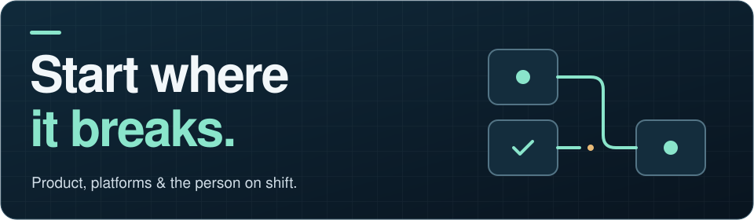

# Hi. I'm Gerald.

**Lead Product Manager, Platform at Panorama Education | ex-HashiCorp | ex-IBM**

  

[Projects](#things-on-this-account) · [How I think](#what-i-actually-care-about) · [The backstory](#the-route-here) · [Off the clock](#off-the-clock)

## Things on this account

### 🧩 [construct](https://github.com/geraldmaron/construct)

**From an outcome to the work.**

Outcome engine. State an outcome, a learning staff of roles fills in the rest.

[Explore the repository →](https://github.com/geraldmaron/construct)

### 📍 [blackstory](https://github.com/geraldmaron/blackstory)

**History has an address.**

Pins Black history to the places it happened. Archiving what would otherwise go unrecorded.

[Explore the repository →](https://github.com/geraldmaron/blackstory)

### ✍️ [geralddagher.com](https://geralddagher.com)

**A little more atmosphere.**

Personal site and writing. Next.js, more atmosphere than a personal site strictly needs.

[Visit the site →](https://geralddagher.com)

---

## What I actually care about

The part of the work nobody photographs. The layer that decides what runs, what stops, and who answers for it. I read the incident reviews before I read the strategy deck.

A few things I keep coming back to:

- **Start where it breaks.** Incidents and workarounds tell you what the roadmap missed.
- **Measure before you promise.** If you can't tell whether the system improved, it's a demo, not a product.
- **Constraints are the brief.** Regulation, latency, cost, headcount. Design around them honestly.
- **Build for the person on shift.** The operator at 2am is the real user. Everything else is a preference.

## The route here

<strong>Bronx kid. Telephone poles. Platforms.</strong>

The short version of how I got here: Bronx kid. Started out climbing telephone poles for AT&T. Then healthcare compliance software, where being wrong gets counted in patients, not points. Then HashiCorp, building reliability and change-risk systems for a nine-figure cloud portfolio, until IBM bought the company partway through. New badge, same laptop 😂.

## Off the clock

Husband, father, South Florida. Foodie as a whole personality trait. Powered by coffee and an amount of Red Bull I'm not going to put a number on 😂.

📫 [me@geralddagher.com](mailto:me@geralddagher.com) · [LinkedIn](https://linkedin.com/in/geraldmdagher) · [geralddagher.com](https://geralddagher.com)
